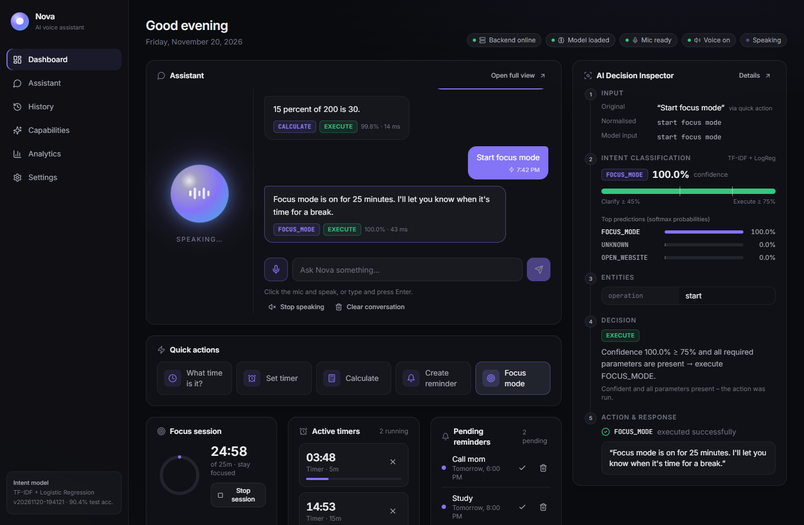
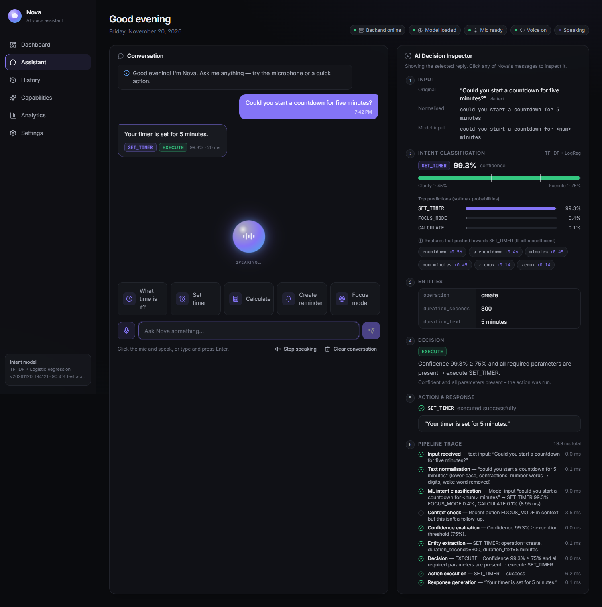
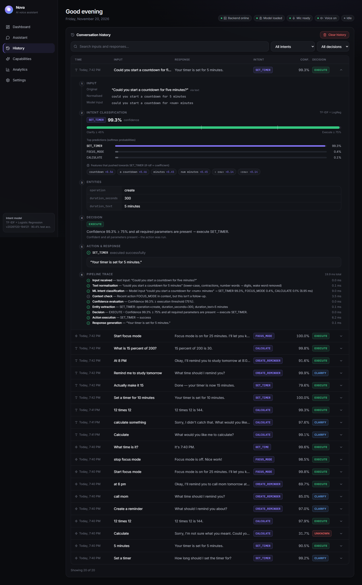
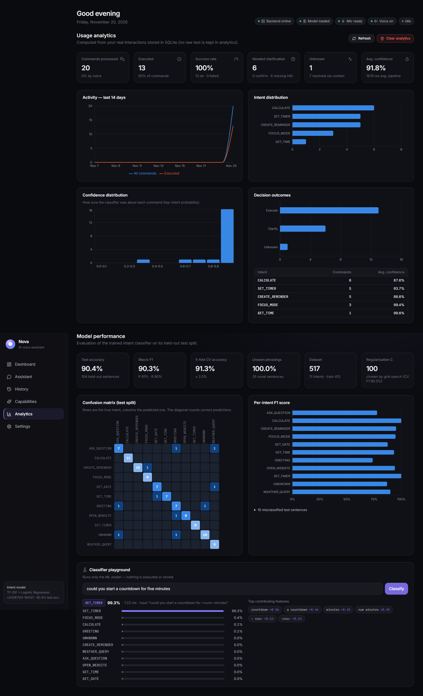
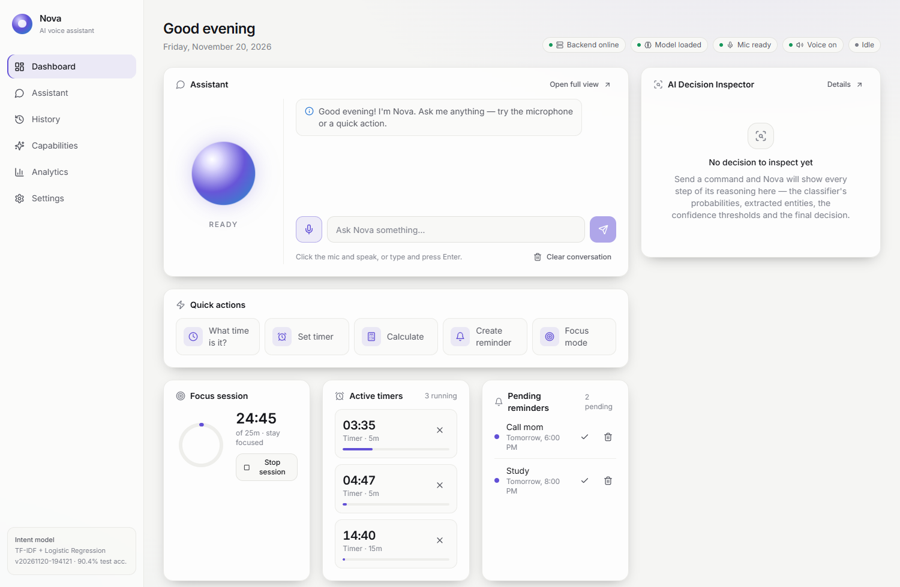
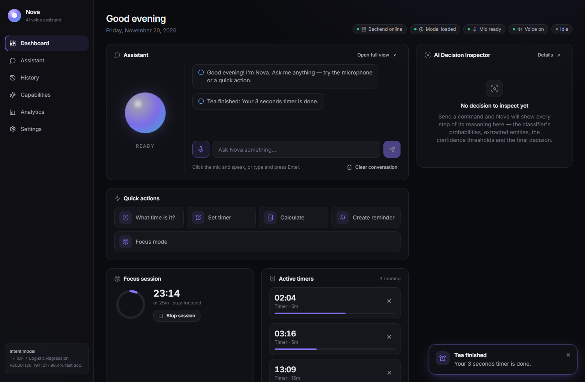

# Nova — AI-Powered Smart Voice Assistant

Nova is a software smart speaker that runs on your own computer. You speak (or type) a request; Nova
transcribes it, **classifies the intent with its own locally trained machine-learning model**, extracts the
parameters, decides — based on the model's confidence — whether to act, ask, or decline, executes the action,
and answers out loud. Every step of that decision is visible in the **AI Decision Inspector**.

It is built as an M.Tech AI/ML project: the emphasis is on a transparent, explainable intent-classification and
decision pipeline rather than sending everything to a large language model.



---

## Contents

1. [Features](#features)
2. [Architecture](#architecture)
3. [Tech stack](#tech-stack)
4. [The ML pipeline](#the-ml-pipeline)
5. [Decision engine & context](#decision-engine--context)
6. [Setup (Windows)](#setup-windows)
7. [Configuration](#configuration)
8. [API](#api)
9. [Testing](#testing)
10. [Project structure](#project-structure)
11. [Screenshots](#screenshots)
12. [Limitations](#limitations)
13. [Future improvements](#future-improvements)

---

## Features

| Capability | What it does | Works offline |
|---|---|---|
| **Voice in / voice out** | Microphone input via the browser's Web Speech API (Chrome/Edge), spoken replies via speech synthesis, voice selection, speech rate, stop button | TTS yes · STT depends on browser |
| **ML intent classification** | TF-IDF (word + character n-grams) + Logistic Regression trained on a custom 517-sentence dataset, 11 intents | ✔ |
| **AI Decision Inspector** | Normalised text, model input, top-3 probabilities, contributing n-gram features, entities, thresholds, decision + reason, pipeline timing | ✔ |
| **Time & date** | Current time, date, weekday, "what day is tomorrow" | ✔ |
| **Calculator** | + − × ÷, percentages, powers, square/cube roots — parsed with `ast`, **no `eval`** | ✔ |
| **Timers** | Multiple concurrent timers, status, cancel, follow-ups ("actually make it 15"); run in the backend and survive restarts | ✔ |
| **Reminders** | Natural date/time parsing ("tomorrow at 9 am", "on monday", "in 2 hours", "tonight"), list/complete/delete, stored in SQLite | ✔ |
| **Focus mode** | Pomodoro-style countdown with completion notification and session statistics | ✔ |
| **Open websites** | Fixed allow-list (YouTube, GitHub, Gmail, …) with fuzzy matching for transcription errors; never arbitrary URLs/commands | ✔ |
| **Weather** | Current conditions & tomorrow's forecast via Open-Meteo (free, no key); clearly says when unavailable, never invents data | needs internet |
| **Questions** | Offline AI/ML knowledge base (TF-IDF retrieval); optionally Claude (Anthropic) or a local Ollama model | KB ✔ · LLM optional |
| **Context** | Slot filling across turns, yes/no confirmation, follow-ups to the last action, expiry | ✔ |
| **History & analytics** | Full history with filters and per-row inspector; usage analytics from real data; model evaluation (confusion matrix, per-class F1) and a classifier playground | ✔ |
| **Settings** | Name, theme (dark/light), start page, voice, thresholds, context timeout, focus length, weather city, privacy controls — persisted in SQLite | ✔ |

---

## Architecture

```
 Browser (React + TS)                                FastAPI backend (Python)
 ─────────────────────                               ─────────────────────────────────────────────────────────
  Mic ─► Web Speech STT ─┐                            POST /api/assistant/process
                         ├─► text ──── REST ────────►  ┌──────────────────────────────────────────────────┐
  Keyboard / quick action┘                             │ 1. Normalisation      (app/nlp/preprocessing)    │
                                                       │ 2. Intent classifier  (app/ml/intent_classifier) │
  Speech synthesis ◄── response ◄──────────────────────│ 3. Context resolution (app/context, engine)      │
  AI Decision Inspector ◄── full trace                 │ 4. Confidence eval    (app/engine/pipeline)      │
                                                       │ 5. Entity extraction  (app/nlp/entities)         │
  Toasts / chime / TTS ◄── GET /api/notifications ◄─┐  │ 6. Decision           EXECUTE/CONFIRM/CLARIFY/…  │
                                                    │  │ 7. Action registry    (app/actions)              │
                                                    │  │ 8. Response + history/analytics (SQLite)        │
                                                    │  └──────────────────────────────────────────────────┘
                                                    └── Scheduler (asyncio, 1 s): completes timers & focus
                                                        sessions, fires due reminders → notifications table
```

Design decisions:

- **Own classifier first, LLM optional.** Every request is classified by the local model; an LLM is only
  consulted for the `ASK_QUESTION` intent and only if configured.
- **Deterministic entity extraction** (regex + a hand-written date/duration parser) keeps parameters exact and
  testable; the ML model only decides *what* the user wants.
- **REST + polling** (2.5 s for notifications) instead of WebSockets — simpler and sufficient for a local app.
- **Timers live in the backend** with absolute end times in SQLite, so they keep running without a browser tab
  and survive restarts.
- **Analytics are anonymised** (`analytics_events` stores intent/confidence/decision only, no text), so clearing
  history does not erase statistics and vice-versa.
- **Swappable layers:** speech-to-text and text-to-speech are isolated in two React hooks; LLM providers sit
  behind one `LLMProvider` interface; the classifier behind `IntentClassifier`.

More detail: [docs/ARCHITECTURE.md](docs/ARCHITECTURE.md).

---

## Tech stack

**Frontend:** React 18, TypeScript, Vite 5, Tailwind CSS 3, lucide-react, Recharts, React Router.
**Backend:** Python 3.11, FastAPI, Pydantic v2, Uvicorn, SQLAlchemy 2 + SQLite.
**ML:** scikit-learn (TF-IDF, LogisticRegression, GridSearchCV), pandas/NumPy, joblib.
**Optional:** `anthropic` SDK (Claude), Ollama (local LLM), Open-Meteo (weather).
**Testing:** pytest + FastAPI TestClient (108 tests).

---

## The ML pipeline

### Dataset — `backend/datasets/intents.json`

517 hand-written utterances, 41–57 per intent, in an easy-to-extend format:

```json
{ "text": "could you start a countdown for five minutes", "intent": "SET_TIMER" }
```

It deliberately includes short commands ("timer 10 minutes"), conversational phrasing, synonyms, typos and
speech-recognition errors ("set a timmer", "what's the whether", "open you tube"), sentences that sit between
intents ("remind me in 30 seconds" → timer; "set an alarm for 6 am" → reminder), and 57 out-of-scope examples for
`UNKNOWN` ("play some music", "turn off the tv", gibberish).

`datasets/intents_unseen.json` holds 35 extra phrasings that never appear in the training data and are used as a
second sanity check of generalisation.

**Intents:** `GREETING`, `GET_TIME`, `GET_DATE`, `CALCULATE`, `SET_TIMER`, `CREATE_REMINDER`, `FOCUS_MODE`,
`WEATHER_QUERY`, `OPEN_WEBSITE`, `ASK_QUESTION`, `UNKNOWN`.

### Preprocessing — `app/nlp/preprocessing.py` (shared by training and inference)

1. Unicode normalisation, lower-casing, wake-word removal ("Hey Nova, …").
2. Contractions expanded ("what's" → "what is"), `a.m./p.m.` unified, hyphens split ("5-minute").
3. Number words → digits ("twenty-five" → 25, "one hundred and fifty" → 150).
4. For the classifier only: every number becomes a `<num>` placeholder, so "timer for 7 minutes" and
   "timer for 45 minutes" are the same input. This helps a small dataset generalise.

### Model — `app/ml/model.py`

```
text ─► FeatureUnion( word TF-IDF 1–2 grams , char_wb TF-IDF 2–5 grams ) ─► LogisticRegression (softmax, balanced)
```

Word n-grams capture phrasing ("remind me", "what time"); character n-grams make the model robust to typos and
mis-transcriptions. Logistic regression gives a probability for every intent (used as the confidence score) and is
fully explainable: the inspector shows the n-grams whose `tf-idf × coefficient` contributed most to the winning class.

### Training — `python ml/train_model.py`

Stratified 80/20 split → 5-fold CV grid search over `C` → evaluation on the held-out split → evaluation on the
unseen file → refit on all data → `artifacts/intent_model.joblib` + `artifacts/training_report.json`.

Current results (held-out test split, 104 sentences):

| Metric | Value |
|---|---|
| Accuracy | **90.4 %** |
| Macro precision / recall / F1 | 90.7 % / 90.3 % / 90.3 % |
| 5-fold CV accuracy (full dataset) | 91.3 % ± 2.6 % |
| Unseen-phrasing accuracy (35 sentences) | 100 % |
| Selected `C` | 100 |

The weakest classes are `GREETING` and `ASK_QUESTION` (F1 ≈ 0.74–0.78): short, open-ended sentences such as
"what are you" or "nothing" are genuinely ambiguous. The full confusion matrix and the misclassified sentences
are printed by the training script and shown on the Analytics page. Because the split is random, numbers move by
a point or two whenever the dataset changes.

The backend loads the model at start-up (and trains one automatically if it is missing). After retraining you can
hot-reload it with `POST /api/model/reload` or the **Reload** button in Settings.

---

## Decision engine & context

`app/engine/pipeline.py` turns a prediction into a decision. Thresholds are user settings (defaults shown):

| Situation | Decision | Behaviour |
|---|---|---|
| confidence < 0.45 | `UNKNOWN` | "I'm not sure what you meant" + capability summary |
| predicted `UNKNOWN` | `UNKNOWN` | "That's not something I can do yet" |
| 0.45 ≤ confidence < 0.75 | `CONFIRM` | "I think you want me to … — should I go ahead?" (stored as pending) |
| ≥ 0.75, required entity missing | `CLARIFY` | asks for the missing slot, keeps the request in context |
| ≥ 0.75, entities complete | `EXECUTE` | runs the registered action |
| user says "cancel / never mind" while something is pending | `CANCELLED` | drops the pending request |

Context handling (`app/context/manager.py`, expires after `context_timeout_seconds`):

```
You:  Remind me to study tomorrow          → CLARIFY  "What time should I remind you?"
You:  At 8 PM                              → EXECUTE  (slot filled from context)
You:  Set a timer for 10 minutes           → EXECUTE
You:  Actually make it 15                  → EXECUTE  follow-up: timer updated to 15 minutes
You:  Cancel it                            → EXECUTE  follow-up: timer cancelled
```

When context overrides the classifier (e.g. "actually make it 15" on its own looks like `CALCULATE`), the
inspector shows both the raw prediction and the context-resolved intent.

---

## Setup (Windows)

**Prerequisites:** Python 3.11+, Node.js 20+ (tested with Python 3.11.5 and Node 22.14), Chrome or Edge for voice input.

### Quick start

```powershell
powershell -ExecutionPolicy Bypass -File scripts\setup.ps1   # venv, pip install, train model, npm install
powershell -ExecutionPolicy Bypass -File scripts\start.ps1   # opens backend + frontend windows and the browser
```

### Manual steps

**Backend** (terminal 1):

```powershell
cd backend
python -m venv .venv
.\.venv\Scripts\Activate.ps1
pip install -r requirements.txt
python ml\train_model.py                       # trains and evaluates the intent model
uvicorn app.main:app --reload --port 8000      # API docs: http://127.0.0.1:8000/docs
```

**Frontend** (terminal 2):

```powershell
cd frontend
npm install
npm run dev                                    # http://localhost:5173
```

The Vite dev server proxies `/api` to `http://127.0.0.1:8000`, so no CORS setup is needed.
Production build: `npm run build` (output in `frontend/dist`).

---

## Configuration

Copy `.env.example` to `.env` (project root or `backend/`). Everything is optional.

| Variable | Default | Purpose |
|---|---|---|
| `NOVA_LOG_LEVEL` | `INFO` | Logging level |
| `NOVA_DATABASE_URL` | `sqlite:///backend/data/nova.db` | SQLite location |
| `NOVA_OPEN_BROWSER_ON_SERVER` | `true` | Open allow-listed sites with the OS browser (otherwise the tab opens them) |
| `NOVA_AUTO_TRAIN_IF_MISSING` | `true` | Train a model on start-up if none exists |
| `NOVA_WEATHER_ENABLED` | `true` | Enable Open-Meteo weather (set a city in Settings) |
| `NOVA_LLM_PROVIDER` | *(empty)* | `anthropic`, `ollama`, or empty for offline only |
| `NOVA_LLM_MODEL` | provider default | e.g. `claude-opus-5-5` or `llama3.2` |
| `ANTHROPIC_API_KEY` | — | Only for the Anthropic provider; read by the backend only |
| `NOVA_OLLAMA_BASE_URL` | `http://localhost:11434` | Ollama server |

API keys are never sent to the frontend, and the log formatter redacts anything that looks like a key or bearer
token. User preferences (thresholds, voice, theme, …) are edited in the **Settings** page and stored in SQLite.

**About the Anthropic provider:** it uses the official SDK with low effort and a short answer length (replies are
spoken), and enables the API's server-side refusal fallback. It has not been exercised against the live API in this
repository's tests (no key was available); the offline path and error handling are tested.

---

## API

Interactive documentation: **http://127.0.0.1:8000/docs** (OpenAPI).

| Method & path | Purpose |
|---|---|
| `GET /api/health` | Backend, database, model and service status |
| `POST /api/assistant/process` | Run the full pipeline on `{text, source, session_id}` |
| `POST /api/assistant/reset-context` | Forget pending questions / last action for a session |
| `GET /api/assistant/capabilities` | Capabilities, availability, examples, website allow-list |
| `GET /api/history` · `DELETE /api/history` | Paginated history (`intent`, `decision`, `search` filters) · clear |
| `GET /api/analytics` · `DELETE /api/analytics` | Usage statistics · clear |
| `GET/POST /api/timers` · `DELETE /api/timers/{id}` | List/create · cancel timers |
| `GET/POST /api/reminders` · `PATCH /api/reminders/{id}/complete` · `DELETE /api/reminders/{id}` · `DELETE /api/reminders` | Reminders CRUD |
| `GET /api/focus` · `POST /api/focus/start` · `POST /api/focus/stop` | Focus mode |
| `GET /api/notifications` · `POST /api/notifications/{id}/read` · `POST /api/notifications/read-all` | Completion events |
| `GET /api/settings` · `PUT /api/settings` · `POST /api/settings/reset` | Preferences (validated) |
| `GET /api/model` · `POST /api/model/predict` · `POST /api/model/reload` | Model info + report · raw prediction · hot reload |

Example:

```http
POST /api/assistant/process
{ "text": "Could you start a countdown for five minutes?", "source": "text", "session_id": "demo" }
```

```json
{
  "intent": "SET_TIMER",
  "confidence": 0.9934,
  "top_intents": [{"intent": "SET_TIMER", "confidence": 0.9934}, {"intent": "FOCUS_MODE", "confidence": 0.0041}, ...],
  "explanation": [{"feature": "countdown", "kind": "word", "weight": 0.56}, ...],
  "entities": {"operation": "create", "duration_seconds": 300, "duration_text": "5 minutes"},
  "decision": "EXECUTE",
  "decision_reason": "Confidence 99.3% ≥ 75% and all required parameters are present → execute SET_TIMER.",
  "action": "SET_TIMER",
  "response": "Your timer is set for 5 minutes.",
  "success": true,
  "pipeline": [{"stage": "normalize", "title": "Text normalisation", "detail": "...", "ms": 0.1}, ...]
}
```

---

## Testing

```powershell
cd backend
.\.venv\Scripts\python.exe -m pytest
```

108 tests, all passing, run against a temporary database with network access and the real browser disabled:

- **ML** (`test_ml.py`): model loads with all intents, predictions on unseen sentences, probability distribution
  sums to 1, explanations, gibberish → low confidence/UNKNOWN, unseen-file accuracy ≥ 85 %, missing model handled.
- **Entities** (`test_entities.py`): durations, reminder message + date/time (12 phrasings), calculator operands and
  results, rejection of code in the evaluator, website matching incl. typos, weather/focus parameters.
- **Actions** (`test_actions.py`): time, date, calculator, timer create/status/cancel/complete, reminder persistence
  and notifications, focus mode, website allow-list, weather not fabricated, knowledge base, crash containment.
- **API** (`test_api.py`): health, process endpoint, invalid input, missing entities → clarification, context
  follow-ups, low confidence, confirmation flow, action failure, CRUD endpoints, settings validation, history/analytics.
- **Core** (`test_core.py`): context expiry and isolation, secret redaction in logs.

The frontend is type-checked as part of `npm run build`.

---

## Project structure

```
Nova/
├── backend/
│   ├── app/
│   │   ├── api/            # FastAPI routers (assistant, tasks, data)
│   │   ├── actions/        # BaseAction, handlers, ActionRegistry
│   │   ├── context/        # conversation context manager
│   │   ├── core/           # config, logging (redaction), time helpers, service container
│   │   ├── database/       # engine / sessions
│   │   ├── engine/         # decision pipeline + response templates
│   │   ├── ml/             # model definition, trainer, runtime classifier
│   │   ├── models/         # SQLAlchemy ORM tables
│   │   ├── nlp/            # preprocessing, numbers, durations, date/time, math, websites, entities
│   │   ├── schemas/        # Pydantic request/response models
│   │   ├── services/       # timers, reminders, focus, notifications, settings, history, analytics,
│   │   │                   # scheduler, weather, knowledge base, llm/ providers
│   │   └── main.py
│   ├── datasets/           # intents.json, intents_unseen.json, knowledge_base.json
│   ├── ml/train_model.py   # training CLI
│   ├── artifacts/          # trained model + training_report.json
│   ├── tests/
│   └── requirements.txt
├── frontend/
│   └── src/ (components, pages, layouts, hooks, services, context, types, utils, styles)
├── docs/                   # ARCHITECTURE.md, PROGRESS.md, screenshots/
├── scripts/                # setup.ps1, start.ps1
├── .env.example
└── README.md
```

---

## Screenshots

| | |
|---|---|
|  **Assistant + AI Decision Inspector** |  **History with per-row inspection** |
|  **Usage analytics & model evaluation** |  **Light theme** |
|  **Timer completion from the backend scheduler** |  **Dashboard with live tasks** |

---

## Limitations

- **Speech recognition** uses the browser's Web Speech API: Chrome and Edge only, and in Chrome the audio is
  processed by Google's online service. Firefox users can type. A local engine (e.g. faster-whisper) can be added
  behind `useSpeechRecognition`.
- **Small dataset.** About 50 sentences per intent is enough for ~90 % accuracy, but unusual phrasings can still be
  misclassified; the confidence thresholds and confirmation step are there to contain that.
- **Rule-based entities.** The date/time parser covers common English phrasings (absolute, relative, weekdays,
  months, "half past", "tonight"…) but not everything ("the second Tuesday of next month").
- **One timezone.** Times are stored as local time of the machine; backend and browser are assumed to be on the
  same computer.
- **Single user**, no authentication — it is designed to run locally.
- **Weather** needs internet; questions beyond the offline knowledge base need an LLM provider.
- Opening a website from a voice command depends on `NOVA_OPEN_BROWSER_ON_SERVER=true`; browsers block pop-ups
  that aren't triggered by a click, so with it disabled Nova shows a link instead.

## Future improvements

- Local speech-to-text (faster-whisper) and neural TTS (Piper) for a fully offline voice loop.
- Transformer sentence embeddings (e.g. a small MiniLM) as an alternative classifier, compared in the analytics page.
- Active learning: let the user correct misclassified commands from History and retrain with one click.
- Learned slot filling (CRF / token classification) for richer entities.
- Optional wake-word detection, recurring reminders, calendar integration, multi-language support.
