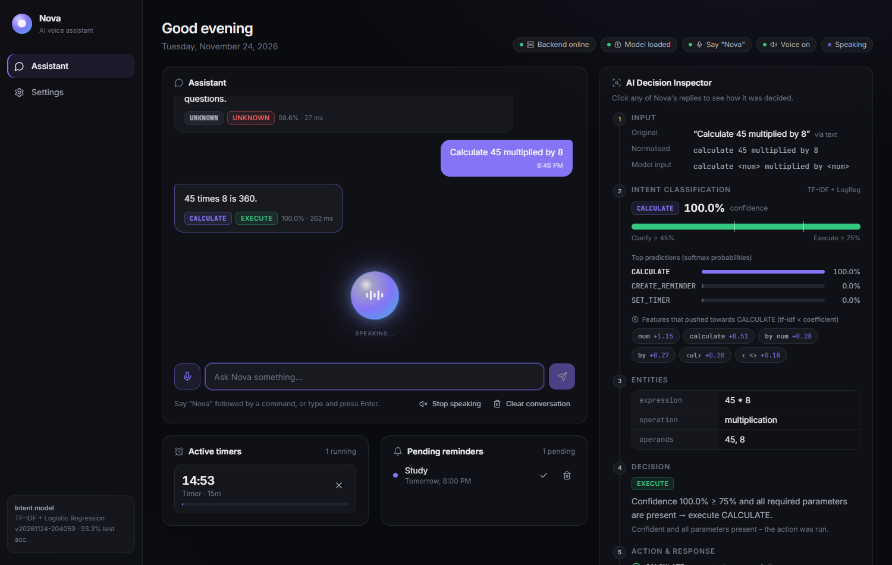

# Nova — a Voice Assistant with Its Own ML Brain

Nova is a small voice assistant that runs on your computer. You say **"Nova, set a timer for 5 minutes"**;
Nova turns the speech into text, **classifies the intent with a machine-learning model it trained itself**,
pulls out the details (5 minutes), decides whether it is confident enough to act, does it, and answers out loud.

The point of the project is the **decision pipeline**, not the number of features: every reply can be opened in
the **AI Decision Inspector** to see exactly how the model and the rules arrived at it.




---

## What Nova can do

| Intent | Example | Notes |
|---|---|---|
| `GREETING` | "Hello Nova" | |
| `GET_TIME` / `GET_DATE` | "What time is it?", "What day is tomorrow?" | offline |
| `CALCULATE` | "What is 15 percent of 200?" | safe parser, **no `eval`** |
| `SET_TIMER` | "Set a timer for 10 minutes", "Cancel my timer" | runs in the backend |
| `CREATE_REMINDER` | "Remind me tomorrow at 9 am to submit the report" | saved in SQLite |
| `OPEN_WEBSITE` | "Open YouTube" | fixed allow-list only |
| `ASK_QUESTION` | "Explain machine learning" | small offline knowledge base |
| `UNKNOWN` | "Play some music" | politely refused |

**Voice:** hands-free — just say **"Nova …"** (wake word). The mic button also works; typing always works.

---

## How it works

```
 "Nova, set a timer for five minutes"
        │  browser speech-to-text (Web Speech API) — only acts when it hears "Nova"
        ▼
 1. Normalise      "set a timer for 5 minutes"        lower-case, "five"→5, wake word removed
 2. Classify       SET_TIMER 99%                       TF-IDF + Logistic Regression
 3. Context        anything pending from before?       e.g. "At 8 PM" answering "What time?"
 4. Confidence     99% ≥ 75%  → allowed to act         thresholds set in Settings
 5. Entities       duration = 300 s                    regex + date/number parsers
 6. Decide         EXECUTE                             (or CONFIRM / CLARIFY / UNKNOWN)
 7. Act            create timer in SQLite              action registry
 8. Reply          "Your timer is set for 5 minutes."  spoken by the browser
```

### Decision rules

| Situation | Decision | What Nova does |
|---|---|---|
| confidence < 45 % | `UNKNOWN` | "Sorry, I'm not sure what you meant" — never guesses |
| model predicts `UNKNOWN` | `UNKNOWN` | "That's not something I can do yet" |
| 45 % – 75 % | `CONFIRM` | "I think you want me to … — should I go ahead?" |
| ≥ 75 % but a detail is missing | `CLARIFY` | asks for it ("What time?") and remembers the request |
| ≥ 75 % and details complete | `EXECUTE` | runs the action |

### Context (short-term memory)

```
You:  Remind me to study tomorrow      → CLARIFY   "What time should I remind you?"
You:  At 8 PM                          → EXECUTE   reminder created (slot filled from context)
You:  Set a timer for 10 minutes       → EXECUTE
You:  Actually make it 15              → EXECUTE   timer changed (follow-up to last action)
You:  Cancel it                        → EXECUTE   timer cancelled
```

Context expires after 2 minutes (configurable).

---

## Code walkthrough (read in this order)

Follow one request through the code — this is everything you need for the viva.

| Step | File | What to look at |
|---|---|---|
| 1. Voice in | [frontend/src/hooks/useWakeWord.ts](frontend/src/hooks/useWakeWord.ts) | `splitWake()` and the continuous recognizer that restarts itself |
| 2. Send | [frontend/src/context/AssistantContext.tsx](frontend/src/context/AssistantContext.tsx) | `send()` → `POST /api/assistant/process`, then speaks the reply |
| 3. API | [backend/app/api/routes_assistant.py](backend/app/api/routes_assistant.py) | `process()` hands the request to the pipeline |
| 4. Pipeline | [backend/app/engine/pipeline.py](backend/app/engine/pipeline.py) | `process()` → `_decide()` → `_extract_and_execute()`; context in `_resolve_pending()` / `_resolve_follow_up()` |
| 5. Normalise | [backend/app/nlp/preprocessing.py](backend/app/nlp/preprocessing.py) | `normalize_text()`, `prepare_for_classifier()` (numbers → `<num>`) |
| 6. Classify | [backend/app/ml/intent_classifier.py](backend/app/ml/intent_classifier.py) | `predict()` (probabilities) and `_explain()` (which words mattered) |
| 7. Entities | [backend/app/nlp/entities.py](backend/app/nlp/entities.py) | one extractor per intent; returns entities + missing slots |
| 8. Actions | [backend/app/actions/](backend/app/actions/) | `registry.py` maps intent → handler; handlers in `basic.py`, `tasks.py`, `external.py` |
| 9. Background | [backend/app/services/scheduler.py](backend/app/services/scheduler.py) | every second: finish due timers, fire due reminders → notifications |
| 10. Inspector | [frontend/src/components/inspector/DecisionInspector.tsx](frontend/src/components/inspector/DecisionInspector.tsx) | renders the pipeline trace returned by the API |

Training lives in [backend/app/ml/model.py](backend/app/ml/model.py) (the model) and
[backend/app/ml/trainer.py](backend/app/ml/trainer.py) (split, grid search, metrics), run by `ml/train_model.py`.

---

## The ML model

- **Data** — [backend/datasets/intents.json](backend/datasets/intents.json): 449 hand-written sentences,
  9 intents (~45 each, 77 `UNKNOWN`), including typos and speech errors ("set a timmer", "open you tube").
  Format: `{"text": "set a timer for 5 minutes", "intent": "SET_TIMER"}`.
- **Features** — TF-IDF on word 1–2-grams (phrasing like "remind me") **plus** character 2–5-grams
  (robust to typos and mis-heard words). Numbers become `<num>` so "7 minutes" and "45 minutes" look the same.
- **Classifier** — multinomial Logistic Regression. Gives a probability per intent (= confidence) and is
  explainable: contribution of a word = its TF-IDF value × the class coefficient.
- **Training** — stratified 80/20 split, regularisation `C` chosen by 5-fold cross-validation, then refit on all data.
  The trained model is committed as `backend/artifacts/intent_model.joblib`; retrain after editing the dataset.

Results (held-out test split of 90 sentences):

| Metric | Value |
|---|---|
| Accuracy | **93.3 %** |
| Macro precision / recall / F1 | 93.9 % / 93.9 % / 93.9 % |
| 5-fold cross-validation accuracy | 92.0 % ± 2.1 % |
| Unseen phrasings (29 sentences never in training) | 100 % |

Weakest classes: `GREETING` (F1 0.84) and `UNKNOWN` (0.88) — short sentences like "sup" or "what are you"
are genuinely ambiguous. `python ml/train_model.py` prints the full per-class table and confusion matrix and
writes them to `backend/artifacts/training_report.json`.

---

## Run it locally (Windows)

Needs Python 3.11+, Node 20+, and Chrome or Edge for voice.

```powershell
powershell -ExecutionPolicy Bypass -File scripts\setup.ps1   # once: install, train model, npm install
powershell -ExecutionPolicy Bypass -File scripts\start.ps1   # backend :8000 + frontend :5173 + opens browser
```

Manual alternative:

```powershell
# terminal 1
cd backend
python -m venv .venv; .\.venv\Scripts\Activate.ps1
pip install -r requirements.txt
python ml\train_model.py
uvicorn app.main:app --reload --port 8000        # API docs: http://127.0.0.1:8000/docs

# terminal 2
cd frontend
npm install
npm run dev                                      # http://localhost:5173
```

Allow the microphone when the browser asks, then say **"Nova, what time is it?"**.

### Tests

```powershell
cd backend; .\.venv\Scripts\python.exe -m pytest     # 99 tests
cd frontend; npm run build                           # type-check + build
```

Tests cover the model (loads, predicts unseen sentences, probabilities), entity extraction (durations,
12 reminder phrasings, calculator, websites), every action, the API (validation, clarification, context,
low confidence, failures) and log redaction.

---

## Deploy (live link)

Backend on [Render](https://render.com), frontend on [Vercel](https://vercel.com), both free; no code changes.

**Backend — Render → New → Web Service**

| Setting | Value |
|---|---|
| Root directory | `backend` |
| Build command | `pip install -r requirements.txt` (the trained model is committed, so no training on the server) |
| Start command | `uvicorn app.main:app --host 0.0.0.0 --port $PORT` |
| Env `PYTHON_VERSION` | `3.11.5` |
| Env `NOVA_OPEN_BROWSER_ON_SERVER` | `false` |
| Env `TZ` | your timezone, e.g. `Asia/Kolkata` (servers run on UTC) |
| Env `NOVA_CORS_ORIGINS` | your Vercel URL, e.g. `https://nova.vercel.app` |

Check `https://<service>.onrender.com/api/health` shows `"status": "ok"`.

**Frontend — Vercel → Add New → Project**

| Setting | Value |
|---|---|
| Root directory | `frontend` |
| Framework preset | Vite |
| Env `VITE_API_URL` | `https://<service>.onrender.com` |

`frontend/vercel.json` makes page refreshes work. Free-tier notes: Render sleeps after ~15 min (first request
then takes ~1 min), its disk resets on restart (reminders are lost), and there are no user accounts — everyone
with the link shares one Nova.

---

## API

Interactive docs at `http://127.0.0.1:8000/docs`.

| Endpoint | Purpose |
|---|---|
| `GET /api/health` | backend + model status |
| `POST /api/assistant/process` | `{text, source, session_id}` → full decision + trace |
| `POST /api/assistant/reset-context` | forget pending questions for a session |
| `GET/POST /api/timers`, `DELETE /api/timers/{id}` | timers |
| `GET/POST /api/reminders`, `PATCH …/{id}/complete`, `DELETE …/{id}` | reminders |
| `GET /api/notifications`, `POST /api/notifications/{id}/read` | timer/reminder alerts for the UI |
| `GET/PUT /api/settings`, `POST /api/settings/reset` | preferences |

**Database (SQLite):** `timers`, `reminders`, `notifications`, `settings`. Conversations are not stored.

---

## Project structure

```
backend/
  app/
    api/        routes_assistant.py, routes_tasks.py, routes_settings.py
    engine/     pipeline.py (the decision logic), responses.py
    ml/         model.py, trainer.py, intent_classifier.py
    nlp/        preprocessing, numbers, duration, datetime_parser, math_expression, websites, entities
    actions/    base.py, registry.py, basic.py, tasks.py, external.py
    context/    manager.py (short-term memory)
    services/   timers, reminders, notifications, settings, scheduler, knowledge_base
    models/     SQLAlchemy tables      schemas/  Pydantic request/response models
    core/       config, logging (hides secrets), time helpers, container
    main.py
  datasets/     intents.json, intents_unseen.json, knowledge_base.json
  ml/train_model.py
  tests/
frontend/src/
  pages/        HomePage.tsx, SettingsPage.tsx
  components/   assistant/, inspector/, tasks/, layout/, ui/
  hooks/        useWakeWord, useSpeechRecognition, useSpeechSynthesis
  context/      AssistantContext (conversation + voice), SettingsContext, SystemContext
scripts/        setup.ps1, start.ps1
```

---

## Viva questions you should expect

- **Why your own classifier instead of ChatGPT?** Explainable (you can see which words decided), fast (~10 ms),
  free, works offline, and it never acts on a guess thanks to the confidence thresholds.
- **Why TF-IDF + Logistic Regression?** Small dataset → a linear model generalises well, trains in seconds, and
  outputs calibrated-enough probabilities. Character n-grams handle typos and speech errors.
- **How did you choose C / the thresholds?** C by 5-fold grid search. The thresholds (75 % / 45 %) are the
  starting values from the project brief, checked against the model's confidence on test sentences (correct
  predictions are mostly above 90 %); they're adjustable in Settings to experiment live.
- **What does the model *not* do?** It only picks the intent. Numbers, dates and website names are extracted
  by deterministic parsers, so they are exact and testable.
- **How is it safe?** No shell commands, no `eval` (calculator uses Python's `ast` with a whitelist), websites
  only from an allow-list, all inputs validated with Pydantic.
- **How does the wake word work?** The browser streams speech to text continuously; the frontend only acts on
  text containing "Nova" and ignores audio while Nova is speaking, so it doesn't trigger itself.
- **Weak points?** Small dataset; rule-based dates don't cover every phrasing; browser speech recognition needs
  Chrome/Edge (and Google's online service in Chrome); single user, no login.

## Limitations

- Voice input works in Chrome and Edge only; Chrome sends audio to Google's speech service.
- The wake word only works while the Nova tab is open.
- Times use the server's clock (set `TZ` when deployed).
- Single user, no authentication.
